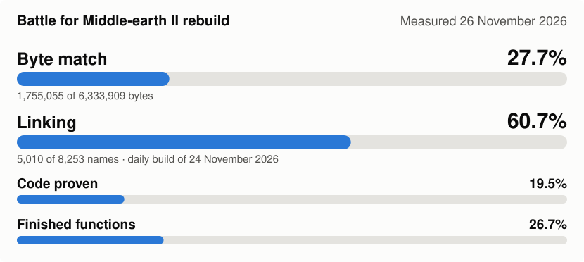
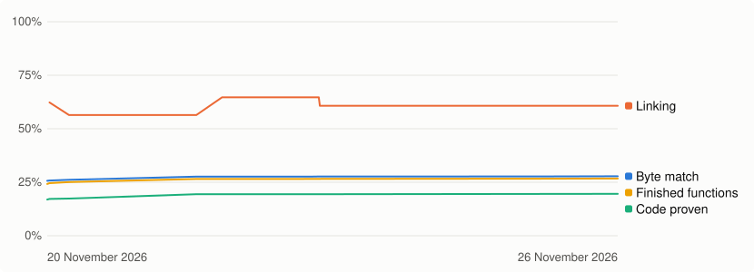

# Battle for Middle-earth II rebuild: progress

How much of the original game (version 1.06) has been rebuilt as source code that compiles back to the same machine code. Measured automatically after every change; nobody edits this page.

Measured **26 November 2026**. The code figures describe commit [`e897cba172dd`](https://github.com/Open-BFME/BFME2-Rebuild/commit/e897cba172ddbb97ef624a67d7a73887875c38a9) (26 November 2026, 16:27 UTC); the build checks run every day.

## The figures

**Byte match**: `██████░░░░░░░░░░░░░░` 27.8% (1,759,484 of 6,333,909 bytes)  
How much of the original game's code, by size, our source code compiles back to byte for byte.

**Linking**: `████████████░░░░░░░░` 60.7% (5,010 of 8,253 names)  
How many of the names the game needs to be assembled into one program our source already provides.
Measured by the daily build of commit [`0fc7d30e48cf`](https://github.com/Open-BFME/BFME2-Rebuild/commit/0fc7d30e48cfd0424b96d4582bce4db53e2d5b1b) (24 November 2026), which can be newer or older than the commit the other figures describe.

**Code proven**: `████░░░░░░░░░░░░░░░░` 19.6% (1,240,540 of 6,333,909 bytes)  
How much of the code, by size, is byte-matched and also confirmed at every place it refers to other code or data, so the match cannot be a coincidence.

**Finished functions**: `█████░░░░░░░░░░░░░░░` 26.7% (11,113 of 41,570 functions)  
Functions that are proven, sit in a properly named source file, and belong to a class declared in a final header. Counted in functions, not bytes: small functions are often finished first, so this figure can be ahead of the byte figures.

## Does the rebuilt game run?

Nightly build of commit [`9dd2e2d4ee8a`](https://github.com/Open-BFME/BFME2-Rebuild/commit/9dd2e2d4ee8a152e0864cc9597323b70b1c3dd54) (26 November 2026): The nightly build failed.

- Starts: not run yet
- Reaches the main menu: not run yet
- Plays a skirmish: not run yet
- Equals the original game: not run yet
- Saves and loads: not run yet

## By part of the game

Byte match, by size, in each part of the source tree, largest part first.

| Part | Byte match | Bar |
| --- | ---: | --- |
| Game engine: GameLogic | 26.1% (397,498 of 1,520,680 bytes) | `█████░░░░░░░░░░░░░░░` |
| Game libraries | 52.6% (575,156 of 1,092,443 bytes) | `███████████░░░░░░░░░` |
| Game engine: GameClient | 20.6% (175,512 of 850,669 bytes) | `████░░░░░░░░░░░░░░░░` |
| Platform layer: W3DDevice | 8.9% (47,409 of 531,698 bytes) | `██░░░░░░░░░░░░░░░░░░` |
| Game engine: Common | 35.5% (109,493 of 308,675 bytes) | `███████░░░░░░░░░░░░░` |
| Game engine: GameNetwork | 51.6% (112,198 of 217,464 bytes) | `██████████░░░░░░░░░░` |
| GameSpy SDK (online library) | 98.4% (105,280 of 106,969 bytes) | `████████████████████` |
| Platform layer: MilesAudioDevice | 0.7% (463 of 64,798 bytes) | `░░░░░░░░░░░░░░░░░░░░` |
| Lua 4.0.1 (scripting library) | 96.9% (61,576 of 63,532 bytes) | `███████████████████░` |
| FESL (EA online library) | 0.0% (0 of 42,125 bytes) | `░░░░░░░░░░░░░░░░░░░░` |
| STLport 4.6 (C++ library) | 86.2% (27,981 of 32,452 bytes) | `█████████████████░░░` |
| nbench (benchmark library) | 0.0% (0 of 26,290 bytes) | `░░░░░░░░░░░░░░░░░░░░` |
| zlib 1.1.4 (compression library) | 100.0% (23,719 of 23,719 bytes) | `████████████████████` |
| ppmalloc 1.26.11 (memory allocator) | 0.0% (0 of 14,445 bytes) | `░░░░░░░░░░░░░░░░░░░░` |
| LZHL 1.0 (compression library) | 99.7% (7,125 of 7,150 bytes) | `████████████████████` |
| Platform layer: Win32Device | 57.0% (1,564 of 2,742 bytes) | `███████████░░░░░░░░░` |
| Not yet placed in a named file | 8.7% (114,510 of 1,323,501 bytes) | `██░░░░░░░░░░░░░░░░░░` |
| Not yet assigned to any file | 0.0% (0 of 104,557 bytes) | `░░░░░░░░░░░░░░░░░░░░` |

Provisional class declarations still in use (files under `include/Draft/` that some source file includes): 11. Each should become a final header.

## Over time

| Commit | Date | Byte match | Linking | Proven | Finished |
| --- | --- | ---: | ---: | ---: | ---: |
| [`e897cba172dd`](https://github.com/Open-BFME/BFME2-Rebuild/commit/e897cba172ddbb97ef624a67d7a73887875c38a9) | 26 November 2026, 16:27 UTC | 27.78% | 60.71% (build `0fc7d30`) | 19.59% | 26.73% |
| [`9dd2e2d4ee8a`](https://github.com/Open-BFME/BFME2-Rebuild/commit/9dd2e2d4ee8a152e0864cc9597323b70b1c3dd54) | 25 November 2026, 21:17 UTC | 27.71% | 60.71% (build `0fc7d30`) | 19.52% | 26.66% |
| [`cca4fc12cfe8`](https://github.com/Open-BFME/BFME2-Rebuild/commit/cca4fc12cfe83ace89e550c3b7e19ad83c0cace4) | 23 November 2026, 14:20 UTC | 27.65% | 60.71% (build `0fc7d30`) | 19.41% | 26.55% |
| [`b011d73f96dc`](https://github.com/Open-BFME/BFME2-Rebuild/commit/b011d73f96dcf5cf79290549d7dd8382eb4bbacb) | 23 November 2026, 14:04 UTC | 27.65% | 64.71% (build `4ae67ee`) | 19.41% | 26.55% |
| [`c87f290c27b5`](https://github.com/Open-BFME/BFME2-Rebuild/commit/c87f290c27b542b4e65b4caa0fdbe40bb442c602) | 23 November 2026, 13:50 UTC | 27.65% | 64.71% (build `4ae67ee`) | 19.41% | 26.55% |
| [`ba9713c5b2e5`](https://github.com/Open-BFME/BFME2-Rebuild/commit/ba9713c5b2e508f744c0e19b99d76c9dfba849bd) | 23 November 2026, 13:35 UTC | 27.65% | 64.71% (build `4ae67ee`) | 19.41% | 26.55% |
| [`cf033cf34be6`](https://github.com/Open-BFME/BFME2-Rebuild/commit/cf033cf34be6dc4d66d58eac9106aa4d35899e69) | 23 November 2026, 12:08 UTC | 27.65% | 64.71% (build `4ae67ee`) | 19.41% | 26.55% |
| [`d910812ef906`](https://github.com/Open-BFME/BFME2-Rebuild/commit/d910812ef906028a2c7111921b58cf1b9c8827b3) | 23 November 2026, 12:02 UTC | 27.64% | 64.71% (build `4ae67ee`) | 19.41% | 26.55% |
| [`aa022f492189`](https://github.com/Open-BFME/BFME2-Rebuild/commit/aa022f4921899e02fff3beb8cff702c4b501dbbc) | 23 November 2026, 11:12 UTC | 27.64% | 64.71% (build `4ae67ee`) | 19.41% | 26.55% |
| [`03d25dad113a`](https://github.com/Open-BFME/BFME2-Rebuild/commit/03d25dad113aae1fa8a88398291d12adbb877923) | 23 November 2026, 11:05 UTC | 27.64% | 64.71% (build `4ae67ee`) | 19.41% | 26.55% |
| [`d072bf9fb0b1`](https://github.com/Open-BFME/BFME2-Rebuild/commit/d072bf9fb0b1e0dd8c2be241bb62e48e3564b508) | 23 November 2026, 10:03 UTC | 27.63% | 64.71% (build `4ae67ee`) | 19.41% | 26.54% |
| [`a0b76de72ee5`](https://github.com/Open-BFME/BFME2-Rebuild/commit/a0b76de72ee5be49e1f46c9242ab3726ff18937b) | 23 November 2026, 09:05 UTC | 27.63% | 64.71% (build `4ae67ee`) | 19.41% | 26.53% |
| [`ae9bb893a44f`](https://github.com/Open-BFME/BFME2-Rebuild/commit/ae9bb893a44fd8d2f597ea925d846882b5cc2072) | 23 November 2026, 08:56 UTC | 27.63% | 64.71% (build `4ae67ee`) | 19.40% | 26.53% |
| [`c6e384baec57`](https://github.com/Open-BFME/BFME2-Rebuild/commit/c6e384baec5784d46a6833af2e82d381180e2192) | 23 November 2026, 08:09 UTC | 27.63% | 64.71% (build `4ae67ee`) | 19.40% | 26.53% |
| [`1ba2c4209b95`](https://github.com/Open-BFME/BFME2-Rebuild/commit/1ba2c4209b950131735db838e44d0d42f4b81505) | 23 November 2026, 07:53 UTC | 27.63% | 64.71% (build `4ae67ee`) | 19.40% | 26.53% |
| [`38e2ce704e8a`](https://github.com/Open-BFME/BFME2-Rebuild/commit/38e2ce704e8a3df65ad545bb6f3dcdde41a47310) | 23 November 2026, 06:59 UTC | 27.63% | 64.71% (build `4ae67ee`) | 19.40% | 26.53% |
| [`31ca4805aeae`](https://github.com/Open-BFME/BFME2-Rebuild/commit/31ca4805aeae624220bca566c0e8d85e9c65e7a4) | 23 November 2026, 06:03 UTC | 27.63% | 64.71% (build `4ae67ee`) | 19.40% | 26.53% |
| [`859d14483f9f`](https://github.com/Open-BFME/BFME2-Rebuild/commit/859d14483f9fa01283a0c37b4737fc9d4ba19440) | 23 November 2026, 05:48 UTC | 27.62% | 64.71% (build `4ae67ee`) | 19.40% | 26.53% |
| [`b0b20aaf98c5`](https://github.com/Open-BFME/BFME2-Rebuild/commit/b0b20aaf98c5e9d8f908e97b2814a9f8dd8fc3ca) | 23 November 2026, 03:05 UTC | 27.62% | 64.71% (build `4ae67ee`) | 19.40% | 26.53% |
| [`85af5809f5e2`](https://github.com/Open-BFME/BFME2-Rebuild/commit/85af5809f5e23f8450d0f6b706e2f9cfefdc226f) | 22 November 2026, 23:11 UTC | 27.62% | 64.71% (build `4ae67ee`) | 19.40% | 26.53% |
| [`a13dbd4f83c8`](https://github.com/Open-BFME/BFME2-Rebuild/commit/a13dbd4f83c8115b42919e02b1069c2138c23172) | 22 November 2026, 22:43 UTC | 27.62% | 64.71% (build `4ae67ee`) | 19.40% | 26.53% |
| [`06bb318f2f18`](https://github.com/Open-BFME/BFME2-Rebuild/commit/06bb318f2f1862db3f0c4fa8da3854dc6077b131) | 22 November 2026, 22:08 UTC | 27.62% | 64.71% (build `4ae67ee`) | 19.40% | 26.54% |
| [`7d3b757bad14`](https://github.com/Open-BFME/BFME2-Rebuild/commit/7d3b757bad14352236dd725a3a1ce092f4bc03bd) | 22 November 2026, 20:17 UTC | 27.62% | 64.70% (build `275e5bc`) | 19.39% | 26.53% |
| [`cf353ffcc35d`](https://github.com/Open-BFME/BFME2-Rebuild/commit/cf353ffcc35deaeff04c647505b0c8b974ca7084) | 22 November 2026, 19:46 UTC | 27.62% | 64.70% (build `275e5bc`) | 19.39% | 26.53% |
| [`531d47ed71b5`](https://github.com/Open-BFME/BFME2-Rebuild/commit/531d47ed71b50e3f52808139d4f3f25a7dbb993b) | 22 November 2026, 19:21 UTC | 27.62% | 64.70% (build `275e5bc`) | 19.39% | 26.53% |
| [`0e08e2d5b542`](https://github.com/Open-BFME/BFME2-Rebuild/commit/0e08e2d5b54243e64a8d29601880166efc6b322e) | 22 November 2026, 18:10 UTC | 27.62% | 64.70% (build `275e5bc`) | 19.39% | 26.53% |
| [`986fc9668bdb`](https://github.com/Open-BFME/BFME2-Rebuild/commit/986fc9668bdb6f4aaf2369f7e86d35eaff153f4d) | 22 November 2026, 15:53 UTC | 27.62% | 64.70% (build `275e5bc`) | 19.39% | 26.53% |
| [`37882787b296`](https://github.com/Open-BFME/BFME2-Rebuild/commit/37882787b2967c189f39983238d336b3a9def9f0) | 22 November 2026, 15:50 UTC | 27.62% | 64.70% (build `275e5bc`) | 19.39% | 26.53% |
| [`275e5bc86e6c`](https://github.com/Open-BFME/BFME2-Rebuild/commit/275e5bc86e6c35cbf28c1c173eafe8dc772c5fdc) | 22 November 2026, 14:00 UTC | 27.61% | 64.70% | 19.39% | 26.52% |
| [`439e43d7c563`](https://github.com/Open-BFME/BFME2-Rebuild/commit/439e43d7c56323576005221fe6ffd4c0ca71ca2c) | 22 November 2026, 07:36 UTC | 27.61% | 56.40% (build `9fa818c`) | 19.39% | 26.52% |

How each figure is computed, with its exact formula: [ci/progress/README.md](https://github.com/Open-BFME/BFME2-Rebuild/blob/main/ci/progress/README.md).
