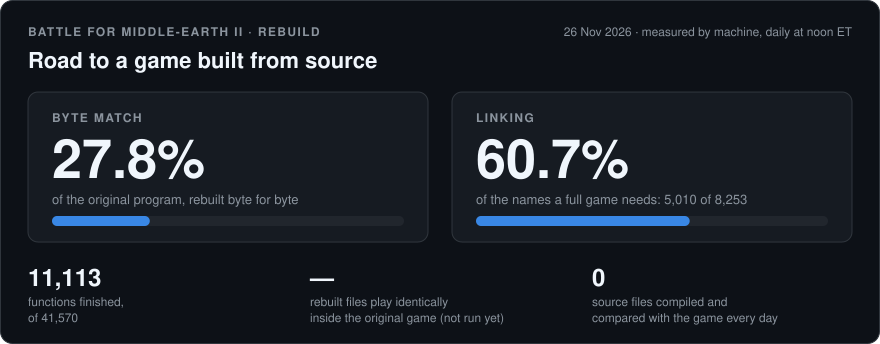

<h1 align="center">Battle for Middle-earth II, rebuilt</h1>

<p align="center">
The engine of <em>The Battle for Middle-earth II</em> (EA, 2006, patch 1.06), rewritten as clean C++<br>
that compiles to the exact bytes of the original game.<br>
When it is finished, anyone can build the game from source, patch it and mod it.
</p>

<p align="center">
<a href="#jump-in">Jump in</a> ·
<a href="#why-a-new-repository">Why a new repository</a> ·
<a href="#roadmap">Roadmap</a> ·
<a href="https://discord.gg/wCvA2XqPUT">Discord</a>
</p>

<p align="center">

</p>

<p align="center"><sub>
<b>Byte match</b> is how much of the original program our C++ compiles back to, byte for byte.
<b>Linking</b> is how many of the names a complete game needs our source already provides.<br>
Machines measure both after every change to <code>main</code> and every day around noon US Eastern.
Not playable yet. <a href="https://github.com/Open-BFME/BFME2-Rebuild/tree/progress">Full progress card</a>
</sub></p>

## Jump in

Most of this code is written by AI coding agents, and yours are welcome. Paste this into yours:

```text
Fork and clone https://github.com/Open-BFME/BFME2-Rebuild, then read AGENTS.md
and docs/agents.md (see docs/swarm.md for multi-agent setups). Pick one small
function from the worklist that has no open PR yet, write clean C++ matching
baseline/game.dat, run tools/gates/gate.py locally until it passes, and open a
ready-for-review pull request from your fork. Fix any measured code refusal
from the report (three rounds at most), then tell me the PR link and what the
checks said.
```

There is no compiler to install: machines check every pull request. Prefer to
work by hand? Start with the [contribution guide](CONTRIBUTING.md), the
[worklist](worklist/README.md) and [five finished files](docs/reference-files.md).

<p align="center">

</p>

## Why a new repository

The earlier project, [Open-BFME-2](https://github.com/Open-BFME/Open-BFME-2),
matched every piece of the game. But the pieces were made one at a time and do
not fit together into something you can build. Here a piece counts only when
it is real source, in its real file. The number starts lower, and every point
stays done. That earlier work is the foundation: this repository is filled in
from it.

<p align="center">

</p>

## Roadmap

- [x] Pull requests are checked and landed with no person in the loop
- [ ] Byte match reaches 100%, with real source only
- [ ] Linking reaches 100%: the game builds from this source alone
- [ ] The rebuilt game starts, plays a skirmish, saves and loads, and equals the original frame for frame
- [ ] Then the fun part: 60/120 FPS, the memory fix, better crash logs, multiple CPU cores, WorldBuilder source

## Read more

[Status in detail](docs/status.md) ·
[Known weaknesses](docs/known-weaknesses.md) ·
[Agents guide](docs/agents.md) ·
[Source rules](RULES.md) ·
[What the checks report](ci/README.md) ·
[Where the numbers come from](docs/measurements.md) ·
[Security](SECURITY.md)

The maintainer is the GitHub account [@Ancalgonn](https://github.com/Ancalgonn).

## Licence and affiliation

This is a modified, derived work. It is not the original program, is not an
Electronic Arts product, and has no affiliation or association with Electronic
Arts Inc. or its affiliates or their employees.

“Command & Conquer” and “Battle for Middle-earth” are named in this repository
only to say which games the code belongs to. This repository is not endorsed by
and does not speak for any owner of those names.

`baseline/game.dat` is the program file of the game, version 1.06, as
Electronic Arts shipped it (its SHA-256 is in `baseline/README.md`). It is in
this repository because everything here is measured against it: the checks
compile each change and compare it with this file, and contributors read the
original bytes of a function from it. It is not covered by this repository's
GPL-3 licence statement, and its presence does not mean any affiliation with,
or endorsement by, Electronic Arts or the owners of the game's names. Apart
from this file the repository holds no executables, game assets or byte
dumps, and contributions may not add any ([CONTRIBUTING.md](CONTRIBUTING.md)).

See [LICENSE](LICENSE) and [NOTICE](NOTICE) for the GPL-3 terms and
third-party notices. The Electronic Arts GPL release and its additional
terms cover the text derived from that release. GameSpy SDK and EA PPMalloc
text retain their own notices and are outside this repository's GPL-3 licence
statement.
